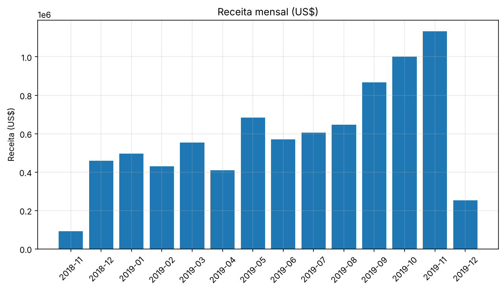
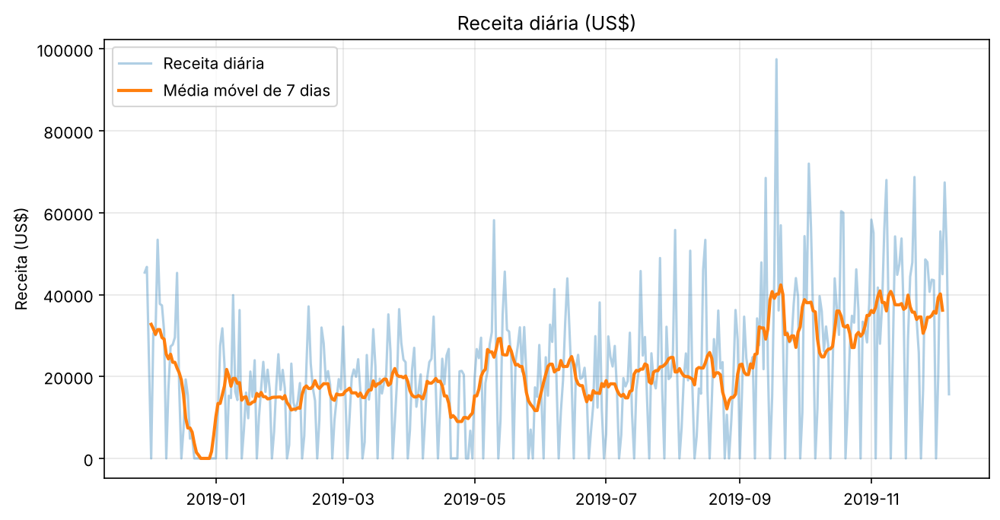
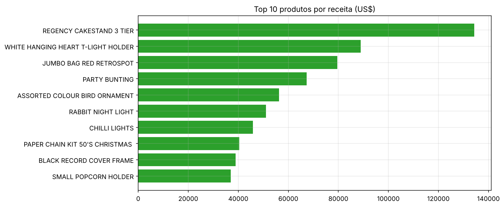
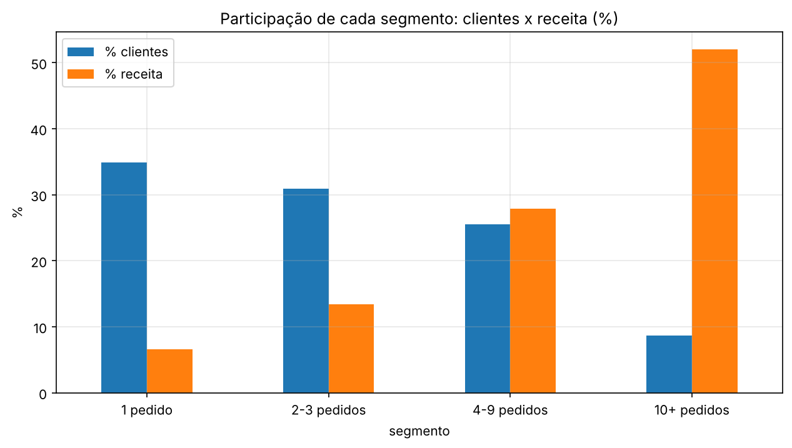

# 🛒 Perfis de Consumidores em E-Commerce

> Limpeza rastreável, análise exploratória, segmentação por produto e frequência de compra e teste de hipótese estatístico sobre o histórico de transações de uma loja online de utensílios domésticos (Everything Plus).


---

## 📌 Contexto de Negócio

A **Everything Plus** vende utensílios domésticos online e quer **ofertas mais personalizadas e eficazes**, mas hoje trata a base de clientes de forma homogênea.

**Pergunta central:** *quem são os nossos consumidores e como o histórico de compras pode orientar campanhas segmentadas?*

**Objetivos**
1. Diagnosticar e tratar a qualidade da base transacional, com rastreabilidade de cada regra aplicada.
2. Entender sazonalidade e KPIs de receita.
3. Segmentar por **produto** (receita) e por **frequência de compra** (pedidos distintos por cliente).
4. Testar estatisticamente se **clientes recorrentes gastam mais** do que clientes de compra única.

---

## 🗂️ Dicionário de Dados

Arquivo `data/ecommerce_dataset_us.csv` (separador de tabulação) · **541.909 linhas × 7 colunas**

| Coluna | Descrição | Observações de qualidade |
|---|---|---|
| `InvoiceNo` | Identificador do pedido (um pedido possui várias linhas, uma por item) | Prefixo **C** indica cancelamento |
| `StockCode` | Identificador do item | Inclui códigos que não são produtos (frete, taxas, ajustes) |
| `Description` | Nome do item | 1.454 nulos |
| `Quantity` | Quantidade do item | Valores negativos e extremos (±80.995) |
| `InvoiceDate` | Data e hora do pedido | Convertida para `datetime` |
| `UnitPrice` | Preço unitário | Valores negativos e extremos |
| `CustomerID` | Identificador do cliente | **135.080 nulos (~25%)** |

**Coluna derivada:** `TotalPrice = Quantity × UnitPrice`.

---

## 🔬 Metodologia

### 1. Diagnóstico e limpeza (com funil de rastreabilidade)
Cada regra é aplicada em sequência e o notebook mostra **quantas linhas saem em cada etapa**:

| Regra | Motivo |
|---|---|
| Remover linhas sem `CustomerID` | Impossível analisar comportamento por cliente |
| Remover cancelamentos (`InvoiceNo` com "C") | Devoluções não são vendas |
| Remover `Quantity ≤ 0` ou `UnitPrice ≤ 0` | Ajustes e erros de entrada |
| Remover códigos que não são produto (`POSTAGE`, `DOTCOM POSTAGE`, taxas) | Distorcem o ranking de itens |
| Remover compras posteriormente canceladas (mesmo cliente, item e quantidade) | A compra original permanece na base e inflaria a receita (visão líquida) |
| Remover duplicatas exatas | Evita dupla contagem |

### 2. Análise Exploratória
KPIs (clientes, pedidos, receita, ticket por pedido), distribuição das variáveis e séries de receita **mensal e diária** (com média móvel de 7 dias).

### 3. Segmentação
- **Por produto:** receita, unidades e pedidos por `StockCode`; concentração de receita no top 10.
- **Por frequência:** número de **pedidos distintos** por cliente, agrupado em 1 · 2-3 · 4-9 · 10+ pedidos, comparando % de clientes × % de receita.

### 4. Teste de Hipótese
- **H₀:** a média do grupo recorrente (≥ 2 pedidos) é menor ou igual à do grupo de compra única.
- **H₁:** a média do grupo recorrente é maior. Nível de significância α = 0,05.
- **Duas métricas por cliente:** `gasto_total` e `ticket_medio` (gasto por pedido). O gasto total favorece a hipótese por construção (mais pedidos, mais gasto); o ticket médio é a comparação mais justa.
- **Testes:** Welch (não assume variâncias iguais) e Mann-Whitney (não assume normalidade, adequado a dados assimétricos), mais **d de Cohen** para medir a relevância prática, e não só a significância.

---

## 📊 Resultados

### Funil de limpeza

| Etapa | Linhas removidas | Linhas restantes |
|---|---:|---:|
| Base original | 0 | 541.909 |
| Sem `CustomerID` | 135.080 | 406.829 |
| Cancelamentos (`InvoiceNo` com "C") | 8.905 | 397.924 |
| `Quantity ≤ 0` ou `UnitPrice ≤ 0` | 40 | 397.884 |
| Frete, taxas e ajustes (não produto) | 1.547 | 396.337 |
| Compras depois canceladas | 5.307 | 391.030 |
| Duplicatas exatas | 5.101 | **385.929** (71,2% da original) |

### KPIs

| KPI | Valor |
|---|---|
| Período analisado | 29/11/2018 a 07/12/2019 |
| Clientes únicos | 4.321 |
| Pedidos únicos | 18.162 |
| Receita total (US$) | 8.199.423,90 |
| Ticket médio por pedido (US$) | 451,46 (mediana: 299,85) |






### Principais insights

1. **Sazonalidade:** a receita cresce no segundo semestre e atinge o pico em **novembro de 2019 (US$ 1.133.700,10)**, com setembro a novembro acima de US$ 860 mil por mês. Novembro de 2018 e dezembro de 2019 estão incompletos na base.
2. **Produtos pulverizados:** entre 3.644 itens, os 10 maiores concentram apenas **7,8% da receita**. Os líderes são *Regency Cakestand 3 Tier* (US$ 134.365,30), *White Hanging Heart T-Light Holder* (US$ 88.895,90) e *Jumbo Bag Red Retrospot* (US$ 79.649,80).
3. **Clientes concentrados:** quem fez **10+ pedidos é 8,7% da base, mas gera 52,1% da receita**. Já os clientes de **1 pedido são 34,9% da base e geram só 6,6%**.

| Segmento | % clientes | % receita | Ticket médio (US$) |
|---|---:|---:|---:|
| 1 pedido | 34,9% | 6,6% | 359,96 |
| 2-3 pedidos | 30,9% | 13,4% | 346,03 |
| 4-9 pedidos | 25,5% | 27,9% | 370,29 |
| 10+ pedidos | 8,7% | 52,1% | 498,63 |

4. **Teste de hipótese (recorrentes: n = 2.815 · compra única: n = 1.506):**
   - **`gasto_total`:** recorrentes gastam significativamente mais (Welch p < 0,001; Mann-Whitney p < 0,001), com **efeito pequeno (d = 0,29)**. Mediana de US$ 1.125,28 contra US$ 252,26. Como esperado, essa métrica favorece os recorrentes por construção.
   - **`ticket_medio`:** **evidência mista**. O Welch não é significativo (p = 0,136), o Mann-Whitney é (p < 0,001), e o **efeito é desprezível (d = 0,04)**. Mediana de US$ 297,97 contra US$ 252,26.
   - **Conclusão:** clientes recorrentes geram mais receita porque **compram mais vezes**, não porque gastam muito mais **em cada pedido**.

### Recomendações para o marketing
- **Fidelização:** programa para os 8,7% de clientes com 10+ pedidos, que concentram 52,1% da receita.
- **Conversão da 2ª compra:** campanhas pós-compra para os clientes de 1 pedido (34,9% da base). Como o ticket por pedido é parecido entre os grupos, o ganho está em **aumentar a frequência**.
- **Calendário:** concentrar estoque e mídia entre setembro e novembro.
- **Cadastro:** estimular a identificação no checkout, já que ~25% das linhas originais não têm cliente.

---

## ⚠️ Limitações

- O pareamento compra × cancelamento exige mesmo cliente, item e quantidade; devoluções parciais não são capturadas.
- Os cortes de frequência (1, 2-3, 4-9, 10+) são uma escolha de negócio.
- O teste compara grupos observados: **correlação, não causalidade**.
- **Datas:** a base do bootcamp parece derivar do dataset público *Online Retail* (UCI, 2010–2011), com as datas deslocadas para 2018–2019.
- **Próximos passos:** segmentação RFM, clusterização (K-Means), análise de cohort/retenção e dashboard interativo.

---

## 📁 Estrutura do Repositório

```
ecommerce-perfis-consumidores/
├── data/                  # coloque aqui ecommerce_dataset_us.csv (não versionado)
├── images/                # gráficos gerados pelo notebook
├── ecommerce_perfis_consumidores.ipynb
├── requirements.txt
├── .gitignore
└── README.md
```

## 🚀 Como Executar

```bash
git clone https://github.com/THMattos/ecommerce-perfis-consumidores.git
cd ecommerce-perfis-consumidores

python -m venv .venv
.venv\Scripts\activate            # Linux/macOS: source .venv/bin/activate

pip install -r requirements.txt

# coloque o dataset em data/ecommerce_dataset_us.csv
jupyter notebook ecommerce_perfis_consumidores.ipynb
```

> O dataset vem do bootcamp e não está versionado por tamanho. O CSV usa tabulação: `pd.read_csv(..., sep='\t')`.

## 🛠️ Stack

`Python` · `Pandas` · `NumPy` · `SciPy` · `Matplotlib` · `Jupyter Notebook`

## 👤 Autor

**Thiago de Mattos**: Estudante de Engenharia de Software | Analista de Dados
🔗 [LinkedIn](https://www.linkedin.com/in/thiago-demattos-rj/) · 💻 [GitHub](https://github.com/THMattos)
